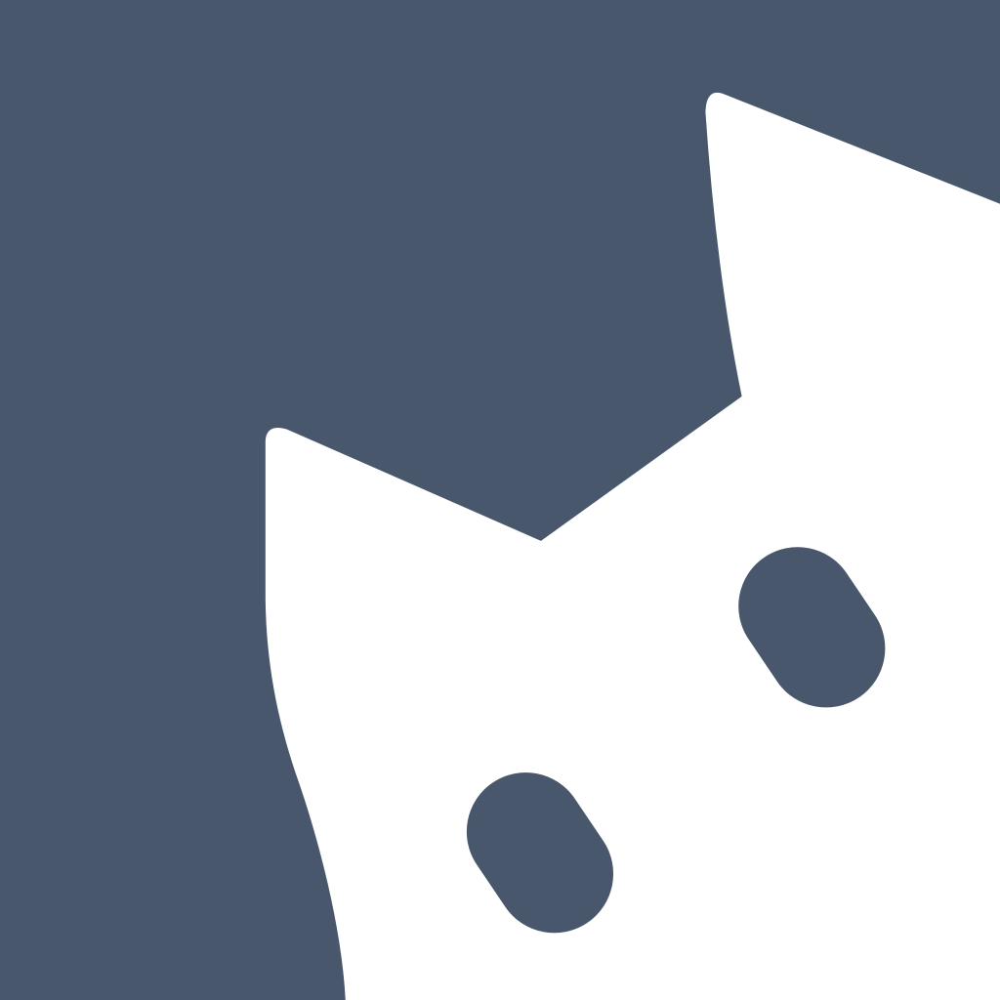

<div align="center">



# ZYX

**A music player for iPhone and Android that cares how your music looks as much as how it sounds.**

[](https://github.com/henrywizzrd/zyx/releases/latest)
[](https://discord.gg/stmhyUDurQ)

[](LICENSE)

</div>

<p align="center">
  
</p>
<p align="center">
  <a href="https://paypal.me/Tysonneee"></a>
</p>

<p align="center">
  
</p>
<p align="center">
  
</p>
<p align="center">
  
  
</p>

---

## Features

- **Vinyl player** — the album spins on a record, with a curved time bar around it and a smoke background tinted by the album art.
- **Live themes** — Smoke, Snow, Sakura, Aurora, Rain, Neon, Starry and more, each with its own moving background.
- **Apple Music–style dock** — a glass tab bar with a sliding highlight, and a vertical dock with a pill-shaped mini player when you turn your phone sideways.
- **Lyrics** while you listen.
- **Offline listening** — download a whole album or playlist with one tap. The button turns green once everything is saved.
- **Built-in log** — send a bug report in a few taps.

## Install

Get the files from the [latest release](https://github.com/henrywizzrd/zyx/releases/latest).

### Android
1. Download `Zyx.apk` on your phone.
2. Open it and tap **Install**. If Android asks, allow your browser to install apps.

### iPhone
ZYX isn't on the App Store yet, so you sign the app yourself:
1. Download `Zyx-unsigned.ipa`.
2. Sign and install it with ESign, [Sideloadly](https://sideloadly.io) or [AltStore](https://altstore.io).

After the first install, updates arrive inside the app — close and reopen it to apply them.

> Used a test build before v1.1.0? Uninstall it first, then install the new version.

## Report a bug

1. In the app, open **Settings › Log**.
2. Tap share and post the log with a short description of what happened in our [Discord](https://discord.gg/stmhyUDurQ).

## Build from source

You'll need Node.js 22. iOS builds need a Mac with Xcode; Android builds need JDK 17 and the Android SDK.

```bash
git clone https://github.com/henrywizzrd/zyx.git
cd zyx
npm ci
npx expo run:ios       # or: npx expo run:android
```

ZYX is built with Expo and React Native. Pull requests are welcome — for big changes, please open an issue first so we can talk it through.

## License

[MIT](LICENSE) © Henry Wizzrd. You're free to use and change the code, as long as you keep the copyright notice.
